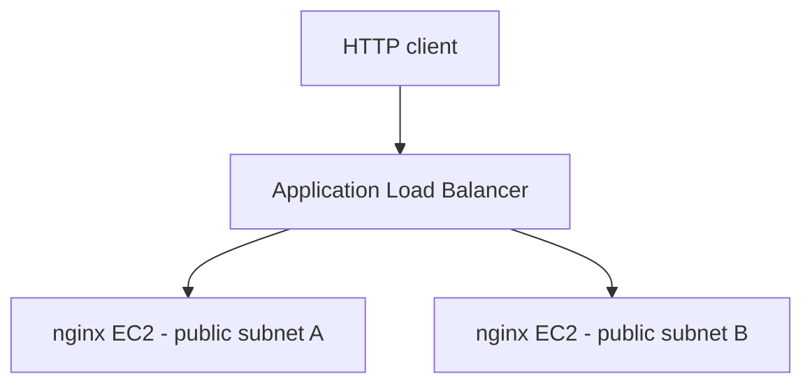

# Terraform AWS Infrastructure Lab

Hands-on AWS infrastructure project built to develop practical experience with Terraform, networking, server provisioning, load balancing, and infrastructure-as-code design practices.

## Related project

[SRE Reliability Lab](https://github.com/blackbird-git/sre-reliability-lab): A containerized Python application with Kubernetes, Prometheus, Grafana, and GitHub Actions CI.

## Completed work

### AWS infrastructure

- Provisioned a VPC with public and private subnets across two Availability Zones in `us-west-2`.
- Configured an internet gateway, public routing, and subnet associations.
- Deployed two Amazon Linux 2023 EC2 instances using an AMI data lookup.
- Bootstrapped nginx installation and service startup with EC2 user data.
- Configured an internet-facing Application Load Balancer, HTTP listener, target group, and instance attachments.
- Restricted inbound HTTP access to the web instances using a reference to the ALB security group.
- Used Terraform plans to review changes before applying them.
- Validated access through the load balancer during the lab.

### Terraform configuration improvements

- Introduced an `environment` input variable to support configurable deployment environments.
- Created reusable local values for common resource tags.
- Used Terraform's `merge()` function to combine shared tags with resource-specific attributes.
- Refactored VPC, subnet, security group, EC2, and load balancer tagging to reduce duplicated configuration.
- Validated the refactored configuration using `terraform fmt`, `terraform validate`, and `terraform plan`.
- Verified that environment tags can be overridden through Terraform CLI variables without editing resource definitions.

These changes improve configuration maintainability by centralizing shared values and reducing the number of locations requiring updates.

## Architecture



The ALB accepts HTTP on port 80. The web instances accept inbound HTTP only from the ALB security group.

Private subnets are defined for future exercises; the current application instances run in public subnets.

## Repository contents

- `main.tf`: Networking, security groups, EC2, load balancer, and outputs.
- `variables.tf`: Configurable Terraform input variables.
- `locals.tf`: Reusable local values, including common resource tags.
- `.terraform.lock.hcl`: Selected provider versions and checksums.
- `.gitignore`: Excludes local Terraform data and state files.

## Working with the configuration

Requires Terraform, AWS credentials, and permission to create the declared resources. The AWS provider requirement is `~> 6.0`.

```bash
terraform init
terraform fmt -check
terraform validate
terraform plan
```

To preview deployment with a different environment tag:

```bash
terraform plan -var="environment=staging"
```

Review the plan before provisioning:

```bash
terraform apply
terraform output -raw alb_url
```

Applying creates billable AWS resources. When finished, review and remove the lab resources:

```bash
terraform plan -destroy
terraform destroy
```

## Project status

The initial infrastructure was successfully deployed and tested, including HTTP access through the Application Load Balancer.

The resources were subsequently destroyed to avoid ongoing AWS charges.

The refactored configuration validates successfully and, with the current empty Terraform state, produces a plan of 23 resources to create.

### Planned improvements

- Refactor repetitive subnet definitions using `for_each`.
- Introduce reusable Terraform modules.
- Explore Terraform state management and remote backends.
- Continue improving configuration organization and reusability.

## Scope and limitations

This is an independent learning project, not a production deployment.

- HTTP only; TLS is not configured.
- EC2 instances are in public subnets and have public IP addresses.
- No Auto Scaling group or automated instance replacement.
- Private subnets have no workloads or NAT gateway configured.
- No shared remote-state backend is defined.
- The AMI lookup selects the latest matching image, so later plans can propose instance changes.
- Direct instance URL outputs are retained from earlier exercises; use `alb_url` to access the application.
