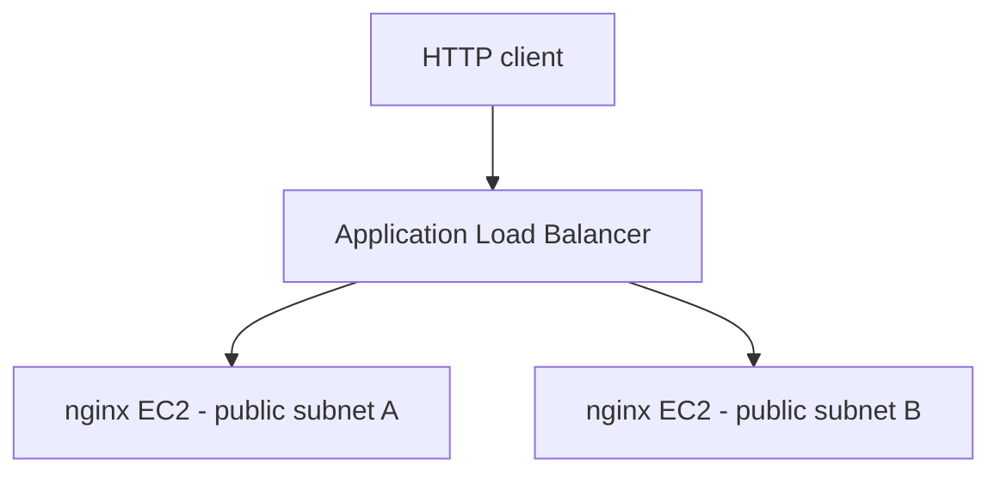

# Terraform AWS Infrastructure Lab

Hands-on AWS infrastructure project built to develop practical experience
with Terraform, networking, server provisioning, and load balancing.

## Completed work

- Provisioned a VPC with public and private subnets across two
  Availability Zones in us-west-2.
- Configured an internet gateway, public routing, and subnet associations.
- Deployed two Amazon Linux 2023 EC2 instances using an AMI data lookup.
- Bootstrapped nginx installation and service startup with EC2 user data.
- Configured an internet-facing Application Load Balancer, HTTP listener,
  target group, and instance attachments.
- Restricted inbound HTTP access to the web instances using a reference
  to the ALB security group.
- Used Terraform plans to review changes before applying them.
- Validated access through the load balancer during the lab.

## Architecture



The ALB accepts HTTP on port 80. The web instances accept inbound HTTP
only from the ALB security group.

Private subnets are defined for future exercises; the current application
instances run in public subnets.

## Repository contents

- `main.tf`: networking, security groups, EC2, load balancer, and outputs.
- `.terraform.lock.hcl`: selected provider versions and checksums.
- `.gitignore`: excludes local Terraform data and state files.

## Working with the configuration

Requires Terraform, AWS credentials, and permission to create the
declared resources. The AWS provider requirement is `~> 6.0`.

```bash
terraform init
terraform fmt -check
terraform validate
terraform plan
```

Review the plan before provisioning:

```bash
terraform apply
terraform output -raw alb_url
```

Applying creates billable AWS resources. When finished, review and
remove the lab resources:

```bash
terraform plan -destroy
terraform destroy
```

## Scope and limitations

This is an independent learning project, not a production deployment.

- HTTP only; TLS is not configured.
- EC2 instances are in public subnets and have public IP addresses.
- No Auto Scaling group or automated instance replacement.
- Private subnets have no workloads or NAT gateway configured.
- No shared remote-state backend is defined.
- The AMI lookup selects the latest matching image, so later plans
  can propose instance changes.
- Direct instance URL outputs are retained from earlier exercises;
  use `alb_url` to access the application.

## Related project

[SRE Reliability Lab](https://github.com/blackbird-git/sre-reliability-lab):
a containerized Python application with Kubernetes, Prometheus,
Grafana, and GitHub Actions CI.